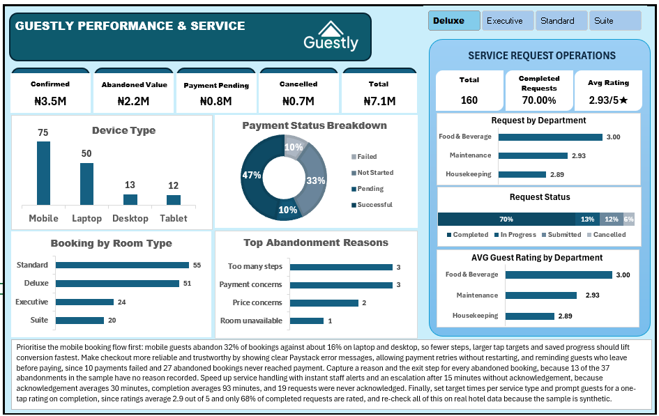

# Guestly: Hotel Booking and Service Operations Analysis

Excel dashboard and findings report from a 5-day Agile sprint on the Digital Guest Experience Platform (DGEP), a responsive web platform for hotel booking and digital concierge service.

> Data note: the dataset is synthetic (150 bookings, 160 service requests), created for training. Findings show how the analysis works, not real hotel performance.

## Project overview

The sprint brief covered nine departments: Product Management, UI/UX, Frontend, Backend, Cybersecurity, Data Analysis, Data Science, AI/ML and Virtual Assistance. The platform targeted two problems: guests abandoning hotel bookings, and slow, poorly tracked service requests.

I led the team and owned the data analysis: cleaning the data, analysing booking and service performance, building the KPI dashboard, and turning the results into recommendations for the other departments.

## Business questions

1. Where and why do guests abandon bookings?
2. Which devices and payment outcomes lose the most bookings?
3. How fast are service requests acknowledged and completed, and how do guests rate them?

## Key findings

- Mobile guests abandon 32% of bookings, versus about 16% on laptop and 15% on desktop.
- "Too many steps" is the top recorded abandonment reason; 13 of 37 abandoned bookings have no reason recorded.
- 10 payments failed, and 27 abandoned bookings never reached payment.
- Service requests take 30 minutes on average to acknowledge and 93 minutes to complete; 19 were never acknowledged.
- Average guest rating is 2.9 out of 5, and only 68% of completed requests are rated.

## Recommendations

- Shorten and simplify the mobile booking flow.
- Make payment recoverable: clear Paystack error messages, retry without restarting, saved progress and reminders.
- Record a reason and exit step for every abandoned booking.
- Send instant staff alerts and escalate requests unacknowledged after 15 minutes.
- Set target completion times per service type and prompt a one-tap rating.

## Tools and methods

Excel (PivotTables, slicers, charts, data cleaning), Agile Scrum, Jira, stakeholder reporting.

## Repository contents

- `Guestly_Performance_Service.xlsx`: cleaned data, pivot tables and the KPI dashboard
- `DGEP_Data_Analysis_Findings_and_Recommendations.docx`: full findings and recommendations by department
- `dashboard.png`: preview of the KPI dashboard

## Dashboard preview

## Limitations

The data is synthetic and the sample is small, so small differences between groups are weak evidence. Findings should be re-checked on real hotel data before design decisions depend on them.

## Author

Orji Sabastine Chibeze | [LinkedIn](https://www.linkedin.com/in/sabastine-orji-b95823415) | [Portfolio](https://sabastineorjic.github.io)
